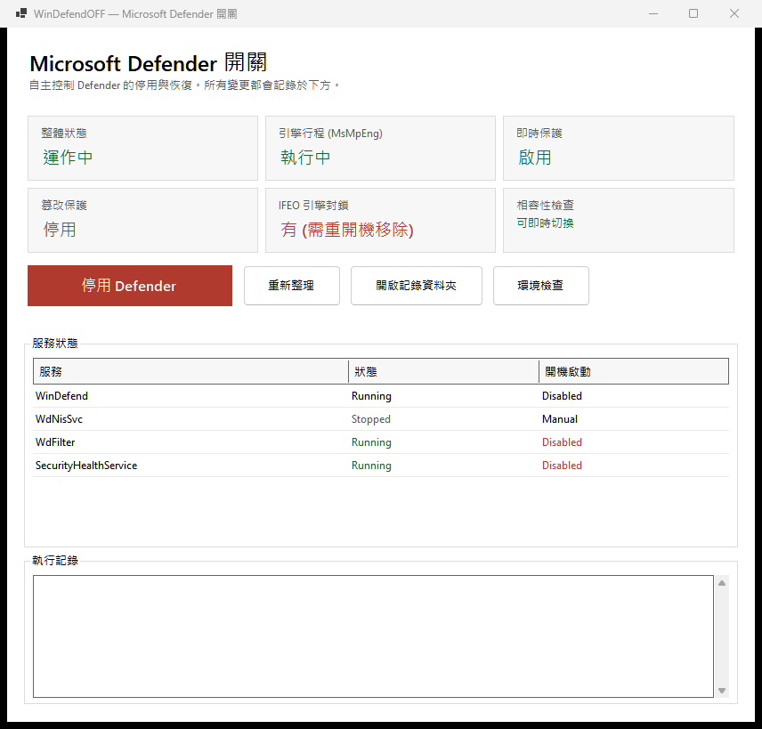

# WinDefendOFF

Windows 上的 Microsoft Defender 開關工具。提供 GUI 與 CLI 兩種介面，**切換不需重新啟動電腦**。

```
停用  →  引擎行程終結 + 封鎖載入 + 服務設為 Disabled
啟用  →  移除封鎖 + 服務設為正常 + 引擎重新啟動
```

---

## 快速開始

### GUI

```powershell
# 建置
dotnet build WinDefendOFF.sln -c Release

# 執行（會自動觸發 UAC 提權）
.\src\WinDefendOFF.App\bin\x64\Release\net8.0-windows\win-x64\WinDefendOFF.exe
```

### CLI

```powershell
$cli = ".\src\WinDefendOFF.Cli\bin\x64\Release\net8.0-windows\win-x64\WinDefendOFF.Cli.exe"

& $cli status      # 查詢現況
& $cli disable     # 停用
& $cli enable      # 啟用
```

CLI 未以管理員身分執行時會自動以 `runas` 重新啟動自身。

---

## 專案結構

```
WinDefendOFF/
├── WinDefendOFF.sln
├── assets/
│   ├── WinDefendOFF.ico         # 應用程式圖示
│   ├── WinDefendOFF.png         # 圖示預覽
│   └── screenshot.png           # 主畫面截圖
├── build/
│   ├── publish.ps1              # 發布腳本
│   ├── WinDefendOFF.bat         # 快捷啟動批次檔
│   └── IconGen/                 # 圖示產生器
├── docs/
│   ├── TECHNICAL.md             # 技術細節與原理
│   └── PUBLISH.md               # 發布與散播說明
├── tests/
│   └── WinDefendOFF.Tests/      # xUnit 測試（45 個）
└── src/
    ├── WinDefendOFF.Core/       # 核心邏輯（類別庫）
    │   ├── Abstractions.cs            # 可注入介面
    │   ├── ScriptBuilder.cs           # PowerShell 腳本生成（純函式）
    │   ├── DefenderController.cs      # 停用／啟用流程
    │   ├── RegistryPaths.cs           # 登錄檔路徑常數與正規化
    │   ├── RegistryEditPlan.cs        # 登錄檔編輯計畫
    │   ├── HiveEditor.cs              # 登錄檔子樹離線編輯
    │   ├── DefenderState.cs           # 狀態模型
    │   ├── DefenderStateReader.cs     # 狀態查詢
    │   ├── CompatibilityChecker.cs   # 環境相容性檢查
    │   ├── SystemTaskRunner.cs        # SYSTEM 身分排程執行器
    │   └── Elevation.cs               # UAC 自我提權
    ├── WinDefendOFF.App/        # WinForms GUI
    └── WinDefendOFF.Cli/        # CLI
```

---

## 發布打包

```powershell
# 一般發布（~0.7 MB，需目標機有 .NET 8 Desktop Runtime）
.\build\publish.ps1

# 攜式發布（單一 exe，~66 MB，免安裝 runtime）
.\build\publish.ps1 -SelfContained

# 打包成 zip
.\build\publish.ps1 -SelfContained -Zip
```

詳細說明（含 Inno Setup 安裝包範本、程式碼簽章）見
[`docs/PUBLISH.md`](docs/PUBLISH.md)。

---

## 相容性

**Windows 版本需求**

| 項目 | 需求 | 說明 |
|---|---|---|
| 作業系統 | Windows 10 1809 (build 17763) 以上 / Windows 11 | x64 架構 |
| 權限 | 系統管理員 | 程式會自動觸發 UAC 提權 |
| 執行階段 | .NET 8 Desktop Runtime | self-contained 版免需 |
| Defender | 必須已安裝 | Windows 10/11 預設即有 |

**程式內建環境檢查**

開啟程式後「相容性檢查」卡片即顯示可否即時切換；點「環境檢查」可看完整報告。
CLI 可用 `WinDefendOFF.Cli check` 取得同樣結果。

```
[ OK ] 系統架構                  64 位元 (x64) — 相符
[ OK ] Windows 版本               Build 26200 — 相符
[ OK ] 系統管理員權限            已提升 — 相符
[ OK ] Microsoft Defender 服務    WinDefend 存在 — 相符
[ OK ] 官方停用機制               Set-MpPreference: 可用；群組原則寫入: 可用；IFEO 封鎖機制: 可用；服務啟動型態: 可用
[ OK ] 服務控制 (protected service) sc start 允許 — 可即時切換

結論：可即時停用 / 啟用，無需重新啟動電腦。
```

**已實測驗證的環境**

| 項目 | 實測值 |
|---|---|
| OS | Windows 11 專業版 25H2 (build 26200) x64 |
| 核心隔離 (HVCI) | 已啟用 — 不影響（不載入任何第三方驅動） |
| 切換往返 | 4 次連續切換全部成功，全程未重開機 |
| 掃描驗證 | `MpCmdRun -Scan` 回 0x800106ba（服務不可用） |

**在其他機器上可能的阻斷因素**

1. **企業版群組原則** — 企業環境可能額外封鎖 IFEO 或服務設定變更。
   環境檢查會在啟動時顯示警告。
2. **Defender 誤判** — 本專案零第三方二進位，誤判機率極低。

上述情況程式不會崩潰，操作記錄會明確標示失敗步驟。

---

## 操作介面



GUI 顯示六個狀態卡：

| 卡片 | 意義 |
|---|---|
| 整體狀態 | 運作中 / 已停用 |
| 引擎行程 (MsMpEng) | 引擎是否在執行 |
| 即時保護 | 即時掃描是否啟用 |
| 篡改保護 | Tamper Protection 是否啟用 |
| IFEO 引擎封鎖 | 是否已封鎖引擎載入 |
| 相容性檢查 | 可即時切換 / 有阻斷問題 |

下方為服務狀態表與執行記錄。記錄同時寫入
`%LOCALAPPDATA%\WinDefendOFF\windefendoff.log`。

---

## 運作原理（摘要）

完整細節見 [`docs/TECHNICAL.md`](docs/TECHNICAL.md)。

### 1. 為什麼需要 SYSTEM 權限

Defender 對自身登錄檔施加 **WRP（Windows Resource Protection）**：

- `HKLM\SYSTEM\CurrentControlSet\Services\WinDefend`
- `HKLM\SOFTWARE\Microsoft\Windows Defender\Features`

即使是本機管理員也無法直接寫入。唯一可行的繞過是
`reg save` → `reg load` → 修改 → `reg restore`，而這需要
**SeBackupPrivilege** 與 **SeRestorePrivilege** —— 這兩個權限對管理員預設是停用的，
只有 SYSTEM 具備。

因此所有變更都透過 `schtasks` 建立一次性 SYSTEM 工作來執行。

### 2. 為什麼「停止」比「啟動」困難

`WinDefend` 是 Windows 的 **protected service**：SCM 拒絕 `sc stop` 與
`sc config`（OpenService FAILED 5），但**允許** `sc start`。

這造成一個不對稱：

| 操作 | 權限 | 結果 |
|---|---|---|
| `sc start WinDefend` | SERVICE_START | ✅ 允許 |
| `sc stop WinDefend` | SERVICE_STOP | ❌ 拒絕 |
| `sc config WinDefend` | CHANGE_CONFIG | ❌ 拒絕 |

`MsMpEng.exe` 同時以 **PPL（Protected Process Light）** 執行，
即使 SYSTEM 也無法對它呼叫 `TerminateProcess`（Access denied）。

**結論**：無法直接「停止」服務或引擎行程。

但**不需要** —— 用三個官方機制即可讓防護完全失效：

1. 關閉即時掃描（引擎不再掃描）
2. IFEO 封鎖（引擎無法被重新載入，`sc start` 會回 577）
3. 服務 `Start=4`（開機不啟動）

實測驗證：

```
MpCmdRun -Scan  → [Failed][0x800106ba] 服務不可用   ← 確實無法掃描
sc start WinDefend → StartService FAILED 577        ← IFEO 攔截
AMServiceEnabled / AntispywareEnabled → False
```

因此本專案**不需要任何第三方核心驅動程式**。

### 3. 完整流程

**停用**

1. `Set-MpPreference -DisableRealtimeMonitoring $true` — 關閉即時掃描與行為監控
2. IFEO 封鎖 `MsMpEng.exe` / `SecurityHealthSystray.exe` / `SecurityHealthService.exe`
   （`Debugger = systray.exe`）—— 阻止引擎載入
3. 服務 `Start` 值設為 `4` (Disabled) —— 確保下次開機不會啟動
4. 群組原則 `DisableAntiSpyware = 1`、`DisableRealtimeMonitoring = 1`
5. 停止服務、結束可結束的行程 —— **立即生效**

**啟用**

1. `Set-MpPreference -DisableRealtimeMonitoring $false` — 恢復即時掃描
2. 移除 IFEO 封鎖
3. 服務 `Start` 值還原（`WinDefend=2`, `WdNisSvc=3`, `WdFilter=0`, `SecurityHealthService=3`）
4. 移除群組原則
5. `sc start WinDefend` / `WdNisSvc` / `SecurityHealthService` —— **立即生效**

---

## 驗證結果

實測於 Windows 11 (build 26200)，全程**未重新啟動電腦**：

```
[enable]  SUCCESS | 引擎執行中: True  | IFEO 封鎖存在: False
[disable] SUCCESS | 引擎執行中: False | IFEO 封鎖存在: True
[enable]  SUCCESS | 引擎執行中: True  | IFEO 封輪存在: False
[disable] SUCCESS | 引擎執行中: False | IFEO 封鎖存在: True

BootTime before = 10/27/2026 18:10:38
BootTime after  = 10/27/2026 18:10:38   ← 未重開機
```

---

## 安全注意事項

- **停用後裝置完全沒有防護**，下載檔、腳本、附件都不會被掃描。
  請勿在恢復前執行不可信程式。
- **零第三方二進位**：本專案僅使用 Windows 官方機制
  （`Set-MpPreference`、IFEO、服務 `Start` 值），不內嵌任何第三方核心驅動程式，
  可自由散播，無授權與誤判疑慮。
- 停用期間 `MsMpEng.exe` 行程可能仍留在記憶體中（受 PPL 保護無法結束），
  但已被 IFEO 封鎖無法重新載入，且即時掃描已關閉 — 防護確實失效。
- 請僅用於自有或已獲授權的裝置。

---

## 參考資源

- [wesmar/WinDefCtl](https://github.com/wesmar/WinDefCtl) — 驅動式終結與 IFEO 手法來源
- [SkyN9ne/DefenderControl](https://github.com/SkyN9ne/DefenderControl) — `reg save/load/restore` 手法研究
- [Breaking through Defender's Gates](https://www.alteredsecurity.com/post/disabling-tamper-protection-and-other-defender-mde-components) — protected service 與篡改保護分析
